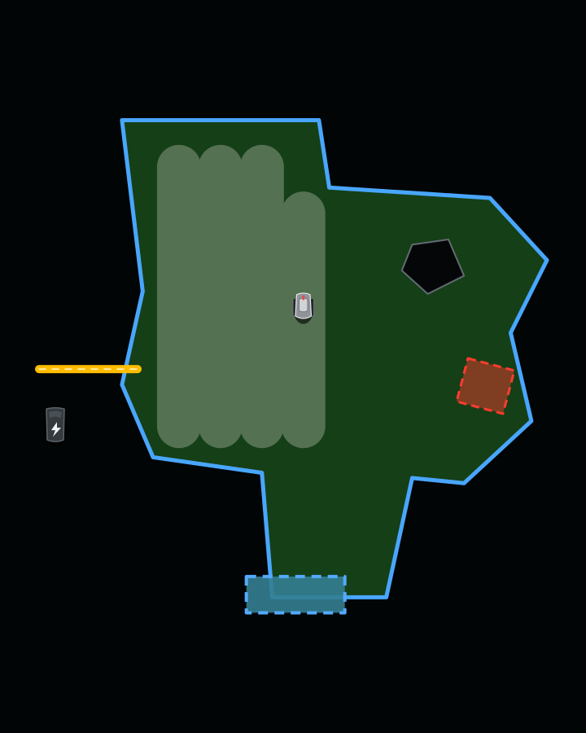

# Eufy Robomow for Home Assistant

[](https://github.com/keesmod/eufy-robomow-ha/actions/workflows/ci.yml)

A Home Assistant custom integration for the **Eufy E15** robotic lawn mower.
By default Home Assistant reads the mower over the Tuya local protocol and its
cloud settings through your Eufy account.

> [!IMPORTANT]
> **Private alpha.** The repository is public, but the integration is still
> being validated. Only the Eufy E15 is supported. No other model, including
> the E18, is claimed. Nothing is published as a release, a tag or through
> HACS.

<p align="center">
  
</p>
<p align="center"><sub>Map preview with synthetic geometry. No private lawn map or device data is stored in this repository.</sub></p>

## What you get

- [Entities](#entities) for the mower's activity, battery, session progress
  and connection, with the latest mowing sessions.
- Start, pause, resume and dock, and the mower settings, only after an
  explicit opt-in to `control`. See the [safety model](#safety-model).
- A read-only [map](#map), which needs the mower bridge or a compatible map
  service.
- A [dashboard card](#dashboard-card) with Dutch labels.
- An experimental, opt-in [rain-aware planning](#rain-aware-planning) package.
- An optional [mower bridge](#mower-bridge) that owns the mower instead of
  Home Assistant.

## Safety model

- New entries start in `observe_only`, and so do entries created by the
  [original integration](#origin-and-license). The mower entity reports state
  but offers no commands, and no setting entities are created.
- `control` is an explicit opt-in in the integration options. The
  [mower bridge](#mower-bridge) needs its own opt-ins as well.
- Each command is sent once. It ends confirmed, rejected or failed, or stays
  unconfirmed, for example after a timeout or when a later pause or dock
  replaces it. An unconfirmed command may still execute, so check the mower
  before you try again. On the local backend a confirmed dock does not prove
  that the mower reached the dock. See
  [Mower backends](docs/backends.md#commands).
- Nothing is repeated automatically or replayed after a reload, a restart or a
  backend switch.
- Enable `control` only after supervised read-only validation. Use it only in
  daylight, with a clear lawn and a known way to stop the mower.
- Never use the integration to bypass the mower's safety protections, such as
  Child Protection or Stop on Rain Detection.

[SECURITY.md](SECURITY.md) and [CONTRIBUTING.md](CONTRIBUTING.md#safety-and-privacy)
have the full safety rules.

## Requirements

- Home Assistant 2026.7.2 or newer, the version CI tests. The maintainer's
  installation was tested on 2026.9.3.
- A Eufy E15 on Wi-Fi, reachable from Home Assistant on the local network.
- The email and password of the Eufy account that owns the mower.
- Optional, for the map: the [mower bridge](#mower-bridge) with
  [map provisioning](docs/bridge-deployment.md#map-provisioning-optional), or
  your own compatible HTTPS map service.

## Installation

1. Copy `custom_components/eufy_robomow/` into the `custom_components/` folder
   of your Home Assistant configuration. Take it from `main`, or build and
   verify a candidate as described in
   [Release candidates](docs/release-candidates.md#build-and-verify).
2. Restart Home Assistant.

HACS installation is not offered or supported. HACS packaging waits for
protocol, safety and reliability validation and for the
[license question](#origin-and-license).

## Configuration

Go to **Settings → Devices & services → Add integration → Eufy Robomow** and
sign in with your Eufy account. The integration discovers your devices and
fetches their local keys. Select the mower and enter its local IP address,
which your router's DHCP table shows.

> [!WARNING]
> The config entry stores your Eufy email and password, the mower's local key
> and, with the bridge backend, the bridge token. Restrict access to Home
> Assistant backups and `.storage`.

Later changes go through **Settings → Devices & services → Eufy Robomow →
Configure**:

| Option | Choices | Default |
| --- | --- | --- |
| Operating mode | `observe_only` or `control` | `observe_only` |
| Mower backend | `local` or `bridge` | `local` |
| Map source | `external` or `bridge` | `external` |

Read the [safety model](#safety-model) before you switch to `control`.

### Mower backend

Exactly one of the two [mower backends](docs/backends.md) owns the mower:

- **local**: Home Assistant reads the mower every 10 seconds over the Tuya
  local protocol, and the cloud settings every 5 minutes in daylight with its
  own Eufy client.
- **bridge**: Home Assistant reads the mower state from the
  [mower bridge](#mower-bridge) at the URL and with the token you enter. It
  opens no mower or cloud connection of its own.

### Map

The map entity reads a validated, read-only map bundle from one of two sources:

- **external**: a compatible HTTPS map service at the URL you enter, with an
  optional certificate pin. This project does not include such a service.
  Without a URL no map entity is created, so a default setup shows no map.
- **bridge**: the experimental map route of the [mower bridge](#mower-bridge).
  It needs the bridge backend and
  [map provisioning](docs/bridge-deployment.md#map-provisioning-optional).

The map is display-only and never drives mower control. It refreshes every two
seconds while a task runs, and every one to five minutes otherwise. Home
Assistant keeps the last good map when an acquisition fails. Map bundles
contain private lawn geometry, so never commit them or attach them to issues.
See [Map sources](docs/map-sources.md).

## Entities

DP numbers refer to the mower's Tuya data points. Created for every entry:

| Entity | Type | Description |
| --- | --- | --- |
| Mower | `lawn_mower` | Activity, and start or resume, pause and dock in `control` |
| Battery | `sensor` | Battery level (%) |
| Mowing Progress | `sensor` | Session completion (%) from DP 113 |
| Session Distance | `sensor` | Distance travelled in the current session (m) from DP 113 |
| Mowed Area | `sensor` | Mowed area counter from DP 126, in raw units with an unconfirmed scale |
| Total Mow Time | `sensor` | Total mowing time (h) from DP 125 |
| Return Progress | `sensor` | Map-save progress (%) from DP 118, at the dock arrival and after a stop |
| Network | `sensor` | Wi-Fi or cellular connection type |
| Signal Strength | `sensor` | Wi-Fi signal strength (%) as the mower declares it |
| Live View State | `sensor` | Live view camera state code from DP 114 |
| Mowing Session | `sensor` | Phase of the current session, with the latest 20 [sessions](docs/backends.md#session-history) as attributes |

A configured [map source](#map) adds the read-only Map (`image`).

Created only in `control`:

| Entity | Type | Description |
| --- | --- | --- |
| Cut Height | `number` | Blade height 25 to 75 mm in 5 mm steps |
| Volume | `number` | Speaker volume 0 to 100 % |
| Edge Distance | `number` | −15 to +15 cm, inside or outside the boundary |
| Pad Direction | `number` | Mowing path angle 0 to 359° |
| Path Distance | `select` | Lane spacing 8, 10 or 12 cm |
| Travel Speed | `select` | Driving speed: slow, normal or fast |
| Blade Speed | `select` | Blade motor speed: slow, normal or fast |
| Stop on Rain Detection | `switch` | The mower's rain stop |
| Child Protection | `switch` | Child and pet protection mode |
| Smart No-Go Suggestions | `switch` | The app's suggested no-go zones |
| Mow Yellow Grass | `switch` | Allow mowing on dry or yellow grass |
| Real Lawn Map | `switch` | The app's real lawn map option, disabled by default |

- Edge Distance, Pad Direction, Path Distance and the two speeds are cloud
  settings (DP 155). The local backend reads them with the stored credentials.
- On the bridge backend only the mower entity, Battery, Network, Signal
  Strength, Mowing Session, the map and the setting entities have data, and
  only some settings are writable. See
  [Mower backends](docs/backends.md#settings).
- Map Coverage and the generic `DP<n>` sensors for unmapped data points are
  disabled by default.

## Dashboard card

1. Enable Advanced mode in your user profile. Then add
   `/eufy_robomow/eufy-mower-card.js?v=0.7.4` as a JavaScript module under
   **Settings → Dashboards → ⋮ → Resources**. The integration serves the file
   but does not add the resource.
2. Create a dashboard from [`examples/dashboard.yaml`](examples/dashboard.yaml),
   or copy its `custom:eufy-mower-card` cards into an existing one, and
   replace the entity ids with your own.

The card uses Dutch labels and shows all sections. Set `view` to `overview`,
`history`, `planning` or `settings` to show one. Its start, pause and dock
buttons need `control` mode, telemetry younger than 45 seconds and a known
activity. Start asks for confirmation, pause is offered only while mowing, and
the card shows each command's result.

## Rain-aware planning

[`examples/eufy_mower_planning.yaml`](examples/eufy_mower_planning.yaml) is an
opt-in, [experimental](docs/release-candidates.md#experimental) package with
Dutch entity names. At most once a day it starts a docked mower in `control`
in a dry daylight window, with the rain stop and child protection on. Its
watchdog sends one pause or dock for sessions it started, without retries.
Automatic mowing starts switched off. Read
[Rain-aware planning](docs/planning.md) before you switch it on.

## Mower bridge

[`bridge/`](bridge/README.md) holds the mower bridge for the `bridge` backend,
a dedicated Node 24 service built on the
[Eufy Mega client](https://github.com/keesmod/eufy-mega-client) library
(`@keesmod/eufy-mega-client`). It runs with or without the
[Eufy Security Viewer Bridge](https://github.com/keesmod/ha-eufy-cam). You
build it yourself as a Docker image or install it as the local Home Assistant
app **Eufy Mower Bridge**. No image or app repository is published.

The bridge starts in `observe_only` and has its own opt-ins:
`operating_mode: control` for start, pause, resume and stop, and
`settings_mode: write` for setting writes. `control` mode also requires
`control_stop_route`, your own description of how to stop the mower when a
command misbehaves. Home Assistant's Dock command sends the bridge's `stop`
command. On the maintainer's E15 the mower then drives back to the dock by
itself. See the [deployment guide](docs/bridge-deployment.md) and the
[bridge README](bridge/README.md#configuration) for all options.

## Upgrading

Back up the installed `custom_components/eufy_robomow` folder and Home
Assistant's `.storage`, replace the folder, run the configuration check and
restart Home Assistant. Entity ids stay the same across versions. When the
card version changes, update the `?v=` part of the dashboard resource.

- Steps and rollback: [integration](docs/migration-and-rollback.md#upgrade-and-rollback-of-the-integration),
  [bridge app](docs/migration-and-rollback.md#upgrade-and-rollback-of-the-bridge-app)
  and [Docker bridge](docs/bridge-deployment.md#upgrade).
- Current versions: integration 0.17.0 with card 0.7.4, bridge and app 0.14.1
  on library 0.27.0. See
  [Release candidates](docs/release-candidates.md#current-candidate).
- Per-version notes: [CHANGELOG.md](CHANGELOG.md) and
  [bridge/CHANGELOG.md](bridge/CHANGELOG.md).

## Known limitations

- **Zone mowing.** The app's Zone, Box and Spot modes have no validated area
  identifiers or command transport, so no zone action is exposed. See
  [zone research](docs/zone-control-research.md).
- **Experimental parts**, such as the bridge map source and the local
  backend's cloud settings, are listed with what passed on the maintainer's
  E15 in [Release candidates](docs/release-candidates.md#experimental).
- **aarch64.** The bridge app declares it, but map acquisition and control
  have only run on amd64.
- **Bridge backend activity** can be unknown while the mower rests. See
  [Mower backends](docs/backends.md#bridge-backend).

## Troubleshooting

- **Entities unavailable**: check the IP address and that the mower is on
  Wi-Fi, not cellular only. With the bridge backend, check that the bridge is
  reachable and reports fresh telemetry.
- **Cloud settings not updating**: a change in the Eufy app appears after the
  next cloud refresh. At night only activity checks reach the cloud, and after
  repeated failures the refresh backs off up to one hour.
- **Debug logging** in `configuration.yaml`:

```yaml
logger:
  logs:
    custom_components.eufy_robomow: debug
```

**Still stuck?** Open an [issue](https://github.com/keesmod/eufy-robomow-ha/issues)
with a short description and redacted log lines. Never attach credentials,
local keys, full device identifiers, coordinates, lawn geometry or raw
captures.

## Documentation

| Document | Contents |
| --- | --- |
| [Mower backends](docs/backends.md) | Activity, commands, settings and sessions per backend |
| [Map sources](docs/map-sources.md) | External and bridge map source contract, validation and caching |
| [Rain-aware planning](docs/planning.md) | Settings, start conditions and watchdog of the planning package |
| [Bridge deployment](docs/bridge-deployment.md) | Running, upgrading and backing up the mower bridge |
| [Bridge README](bridge/README.md) | Bridge options, private API routes and map provisioning |
| [Bridge app](ha_app/README.md) | Installing and operating the local Home Assistant app |
| [Migration and rollback](docs/migration-and-rollback.md) | Moving between backends and map sources, upgrades and rollbacks |
| [Release candidates](docs/release-candidates.md) | How a candidate is built and what is hardware-confirmed |

For contributors: [protocol provenance](docs/protocol-provenance.md) of the
confirmed data points, the [map recovery](docs/map-recovery.md) policy,
[zone control research](docs/zone-control-research.md) and the
[architecture decisions](docs/architecture/).

## Contributing and security

See [CONTRIBUTING.md](CONTRIBUTING.md) for the workflow, checks and protocol
provenance rules, and [SECURITY.md](SECURITY.md) for reporting a vulnerability.

## Origin and license

This is an independent project, not affiliated with Eufy or Anker. It started
as a fork of
[jnicolaes/eufy-robomow-ha](https://github.com/jnicolaes/eufy-robomow-ha) and
keeps its history up to upstream 0.4.0 and the fixes that followed
([ADR 0001](docs/architecture/0001-adopt-github-fork.md)). Its Eufy sign-in,
local-key discovery, local polling and cloud settings come from that work. The
authentication and local-key discovery build on eufy-clean-local-key-grabber,
and the local protocol uses [tinytuya](https://github.com/jasonacox/tinytuya).

The upstream repository declares no license, and this repository does not add
one. Releases, HACS publication and relicensing wait until that is resolved.
